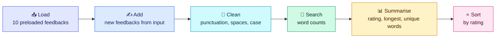

<div align="center">


**A text-based feedback analysis tool built with core Python.**

👉 **[Open the notebook](./Survey_Feedback_Analyzer.ipynb)**

</div>

---

## 📌 Overview

Survey feedback is only useful if someone can turn the comments into something readable. Going through a handful of entries by hand is easy, but it gets slow and uneven as the list grows. This project does that first pass automatically.

The feedback is kept in a dictionary of lists (serial number, name, comment, rating). The program lets the user add new entries, cleans the comments so that "Good", "GOOD" and "good!!" count as the same word, and then answers a few simple questions about the data.

---

## 🗺️ Project Flow



---

## ✨ Features

| Feature | What it does |
|---------|--------------|
| 📥 **Preloaded data** | Starts with 10 feedback entries in a dictionary of lists |
| ✍️ **Add your own** | Takes name, feedback and a rating from 1 to 5, and asks again if the input is wrong |
| 🔢 **Automatic serial numbers** | New entries continue from `S_No` 11 without the user typing them |
| 🧹 **Text cleaning** | Removes punctuation, extra spaces and capital letters |
| 🔎 **Word search** | `count_word_in_feedbacks(word)` counts how many feedbacks contain a word, ignoring case |
| 📊 **Summary** | Average rating, longest comment by word count, and all unique words |
| ⭐ **Sorting** | Lists feedbacks from highest to lowest rating using `zip()` and `sorted()` |

---

## 🖥️ Sample Output

From the saved run in the notebook: 12 feedbacks (10 preloaded and 2 added).

| 🗂️ Feedbacks | ⭐ Average Rating | 📝 Longest Comment | 🔤 Unique Words |
|:---:|:---:|:---:|:---:|
| **12** | **3.58** | **7 words** | **30** |

```text
Feedbacks containing "good":      4
Feedbacks containing "poor":      2
Feedbacks containing "excellent": 2

Average rating: 3.58

Longest feedback : poor response and poor handling of issue
Given by         : Kiran
Word count       : 7
Rating           : 1

Number of unique words: 30
```

---

## 📂 Project Structure

| File | What it is |
|------|------------|
| 📓 [Survey_Feedback_Analyzer.ipynb](./Survey_Feedback_Analyzer.ipynb) | The full project: every step with code, explanations and saved outputs |
| 📄 [README.md](./README.md) | Project overview and how to run it |
| ⚖️ [LICENSE](./LICENSE) | MIT license terms |

---

## 🧠 How It Works

| Step | What happens |
|------|--------------|
| **1. Load** | The 10 feedbacks are loaded into `feedback_data` |
| **2. Add** | The user chooses how many more to add. Each one is checked and added, and serial numbers continue from 11 |
| **3. Clean** | Every comment is cleaned using `replace()`, `split()`, `join()`, `strip()` and `lower()` |
| **4. Search** | `count_word_in_feedbacks()` counts feedbacks containing "good", "poor" and "excellent" |
| **5. Summarise** | The final data, average rating, longest comment and unique words are printed |
| **Extra** | Feedbacks are sorted by rating with `zip()` and `sorted()` |

---

## 🛠️ Concepts Used

`dictionary of lists` · `for` and `while` loops · `if` conditions · `try` / `except` · string methods · user-defined functions · `set` · `zip()` · `sorted()` with `lambda`

---

## 🚀 Getting Started

**You need:** Python 3.8 or higher and Jupyter Notebook. No other libraries.

```bash
git clone https://github.com/AnsaniaSalam/Survey-Feedback-Analyzer-Python.git
cd Survey-Feedback-Analyzer-Python
jupyter notebook Survey_Feedback_Analyzer.ipynb
```

Run the cells from top to bottom. Step 2 asks for input, so type your answers in the box under that cell. Enter `0` to skip adding feedbacks.

---

## 🔮 Future Improvements

- Read feedback from a CSV file instead of typing it in
- Mark each feedback as positive or negative using the rating
- Plot the rating spread with `matplotlib`

---

## 👤 Author

**Ansania Salam**

[](https://www.linkedin.com/in/ansania-salam)
[](https://github.com/AnsaniaSalam)

---

## ⚖️ License

This project is licensed under the **MIT License**. See the [LICENSE](./LICENSE) file for details.


